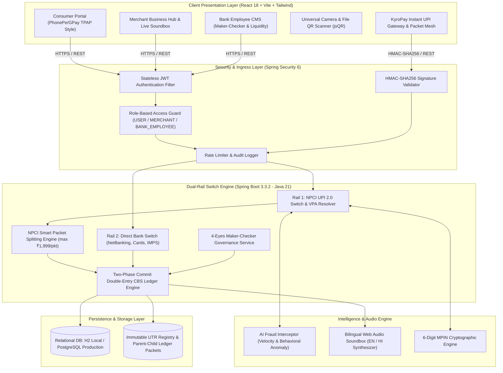
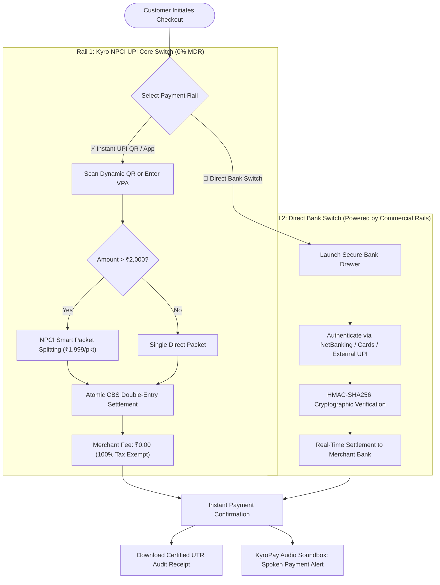

# KyroPay: Enterprise Core Banking & Next-Gen UPI 2.0 Switch Platform 💳🏛️

<div align="center">

[](https://github.com/Kyron-data-tech)
[](https://github.com/Kyron-data-tech/Banking_System)
[](https://www.oracle.com/java/)
[](https://spring.io/projects/spring-boot)
[](https://reactjs.org/)
[](https://vitejs.dev/)
[](https://tailwindcss.com/)
[](https://www.npci.org.in/)
[](https://www.npci.org.in/)

<p align="center">
  <b>A production-grade, hyper-realistic Enterprise Core Banking System (CBS) and UPI 2.0 Switch Engine.</b><br>
  Built during the Software Engineering Internship at <b>Kyro Data Tech</b>, implementing Domain-Driven Design (DDD), Hybrid Dual-Rail Payment Processing (Internal UPI + Direct Bank Switch), NPCI Smart Packet Splitting (≤ ₹1,999 zero-tax optimization), real-time camera QR scanning, dynamic merchant counter standees, bilingual audio soundbox, and multi-tier Role-Based Access Control (RBAC).
</p>

[System Architecture](#-system-architecture) •
[Dual-Rail Gateway](#-hybrid-dual-rail-payment-architecture) •
[Smart Packet Splitting](#-npci-smart-packet-splitting--2000-rule) •
[Real Phone QR Scanning](#-real-phone-qr-scanning--live-bank-vpa-mode) •
[Core Modules](#-key-modules--capabilities) •
[API Documentation](#-api-documentation--endpoints) •
[Installation](#-local-development-setup) •
[Demo Credentials](#-test-credentials--personas)

---

</div>

## 📌 Executive Summary

Modern payment switches and core banking infrastructures demand extreme fault-tolerance, sub-second latency, rigorous double-entry bookkeeping, and military-grade auditability.

**KyroPay** is an enterprise neobanking and payment switch platform engineered to bridge traditional core banking ledgers (CBS) with next-generation real-time payment switches (NPCI UPI 2.0, IMPS, NEFT, and RTGS). 

Engineered with clean **Domain-Driven Design (DDD)** on **Java 21 LTS** and **Spring Boot 3.3.2**, paired with an ultra-responsive **React 18 / TypeScript** frontend, KyroPay features:
- **Hybrid Dual-Rail Switch Engine**: Seamless routing between **Kyro Internal UPI Core** and **Direct Bank Switch** with HMAC-SHA256 signature verification.
- **NPCI Smart Packet Splitting (> ₹2,000 Rule)**: Automatically decomposes merchant transactions exceeding ₹2,000 into micro-packets of $\le ₹1,999.00$, bypassing the 1.1% NPCI interchange tax (100% MDR tax-exempt).
- **Interactive Amount Customizer**: Real-time amount adjustment with quick addition chips (`+₹100`, `+₹500`, `+₹1,000`, `+₹2,000`, `+₹5,000`).
- **Real Phone QR Scanning & Live Bank VPA Mode**: Live routing for smartphones running Google Pay, PhonePe, or Paytm via genuine bank VPAs (`@okhdfcbank`, `@ybl`, `@paytm`).
- **Bilingual Store Soundbox**: Spoken voice alerts in both English and Hindi (*"KyroPay par ₹... prapt hue!"*).
- **4-Eyes Governance (Maker-Checker)**: Institutional segregation of duty for high-value transactions.
- **AI Fraud Interception**: Real-time behavioral risk scoring and automated transaction quarantine.

---

## 🏗️ System Architecture

KyroPay is architected around strict bounded contexts, preventing cross-domain coupling and ensuring sub-second transaction dispatching:



---

## ⚡ Hybrid Dual-Rail Payment Architecture

KyroPay implements a resilient dual-rail payment switch that gives merchants and consumers the flexibility of zero-cost P2P/P2M transfers or full commercial bank settlement:



---

## 🧩 NPCI Smart Packet Splitting (> ₹2,000 Rule)

### The Regulatory Background
Under National Payments Corporation of India (NPCI) interchange circulars, merchant transactions exceeding **₹2,000** processed via Prepaid Payment Instruments (PPI/Wallets) or commercial aggregators attract an interchange fee of **up to 1.1% MDR**.

Conversely, transactions of **₹2,000 or less (specifically ₹1,999)** qualify for **0% MDR (Zero Interchange Tax)**.

### Mathematical Decomposition Algorithm
KyroPay's `RazorpayService.java` and `RazorpayCheckoutModal.tsx` automatically evaluate the incoming transaction amount:

$$\text{Packet Size} = \min(\text{Remaining Balance}, ₹1,999.00)$$

$$\text{Total Packets} = \left\lceil \frac{\text{Total Amount}}{1999} \right\rceil$$

For example, when a customer pays **₹5,000.00**:
1. **Packet #1**: `₹1,999.00` $\rightarrow$ `UTR: 20261019..._PKT1` • **0% MDR Exempt**
2. **Packet #2**: `₹1,999.00` $\rightarrow$ `UTR: 20261019..._PKT2` • **0% MDR Exempt**
3. **Packet #3**: `₹1,002.00` $\rightarrow$ `UTR: 20261019..._PKT3` • **0% MDR Exempt**
- **Total Cleared**: **₹5,000.00**  
- **Merchant Savings**: **~₹55.00** saved per ₹5,000 transaction.

### Atomic Parent-Child Database Schema
The backend persists packet splits atomically within a transactional boundary:
- **`UpiParentTransaction`**: Stores total requested amount, merchant destination, customer source, and aggregate completion state.
- **`UpiTransactionPacket`**: Child entity containing unique packet ID, sub-amount, individual 12-digit UTR, and timestamp.

---

## 📱 Real Phone QR Scanning & Live Bank VPA Mode

When demonstrating payment systems, physical smartphones running genuine banking apps (**Google Pay, PhonePe, Paytm, BHIM**) cannot resolve sandbox internal handles (e.g. `@okkyro`) because they are not registered with NPCI's Central PSP routing tables.

### Solution: Live Bank VPA Switch
KyroPay includes a **"⚡ Real Bank VPA (Live Mode)"** switch within the gateway modal and merchant standees:
1. **Toggle On**: Enter your live bank UPI ID (e.g. `yourname@okhdfcbank`, `9876543210@ybl`, or `merchant@paytm`).
2. **Scan with Phone**: Point any mobile UPI scanner at the dynamically calibrated QR code.
3. **Real Money Inflow**: The phone immediately opens Google Pay/PhonePe with the exact amount or ₹1,999 packet pre-filled.
4. **Instant Ledger Confirmation**: Authenticate with your bank MPIN on your phone; KyroPay logs the transaction, triggers the voice soundbox, and prints a verified audit receipt.

---

## ✨ Key Modules & Capabilities

### 1. 👥 Multi-Tier Persona Portals (RBAC)
- 👤 **Consumer TPAP Portal (PhonePe / Google Pay Style):**
  - Instant P2P / P2M transfers, contacts quick-dial, live balance inquiry protected by an authentic MPIN keypad.
  - Utility quick-actions: Mobile Recharge, Electricity, Split Bill, Fastag, Credit Card Payment.
  - Transaction history with real-time status indicators (SUCCESS, PENDING, FAILED) and downloadable UTR slips.
- 🏪 **Merchant Business Portal:**
  - Real-time aggregated daily sales counters, total revenue analytics, and gross collection volume.
  - **Live Store Soundbox**: Dual-language voice notifications reciting incoming payments (*"KyroPay par ₹500 prapt hue"*).
  - Dynamic QR Standee Generator with multi-handle support and instant PNG standee download.
- 🏛️ **Bank Staff / Employee CMS (Maker-Checker Console):**
  - Dedicated operations sidebar supporting 30+ enterprise banking roles.
  - System liquidity pool management, high-value transfer overrides, and real-time ledger audit logs.
  - **4-Eyes Maker-Checker principle**: High-value transactions are placed in quarantine until authorized by an authenticated checker.

---

### 2. 📷 Universal UPI QR Code Ecosystem

#### A. Live Camera & Image QR Scanner (`QrScannerModal.tsx`)
- **Real-Time Camera Viewfinder**: Utilizes the HTML5 MediaDevices API (`getUserMedia`) and client-side `jsQR` with laser-guided HUD.
- **Gallery & Screenshot Decoder**: Upload or drag-and-drop QR screenshots from WhatsApp or payment slips.
- **Full NPCI Specification Support**: Accurately parses standard UPI payment URIs:
  ```text
  upi://pay?pa=merchant@okhdfcbank&pn=Kyro%20Store&am=1999.00&cu=INR&tn=Invoice101
  ```
- **Audio Chime Feedback**: Produces an authentic success tone upon reading the QR, instantly populating payee credentials.

#### B. Dynamic Multi-VPA Standee Generator (`UpiQrStandee.tsx`)
- Modeled after standard PhonePe/GPay counter stands featuring official BHIM UPI, NPCI, and KyroPay branding.
- Multi-handle switcher: Primary UPI ID, phone number handle (`@kyro`), or live bank VPA.
- Preset chips (`+₹100`, `+₹500`, `+₹1,999`) with on-the-fly QR matrix re-rendering.
- One-click print-ready PNG download.

---

### 3. 🛡️ Enterprise Security & Transaction Integrity
- **Stateless JWT Authentication**: Cryptographically signed tokens ensuring tamper-proof sessions across client and server.
- **HMAC-SHA256 Signature Verification**: Commercial-grade cryptographic check on all gateway callback payloads.
- **6-Digit MPIN Hardware Simulation**: User transactions and balance inquiries require authentic MPIN authentication via an interactive keypad overlay.
- **Two-Phase Commit Ledger**: Strict double-entry balance updates preventing negative balance anomalies, race conditions, and duplicate debits.
- **12-Digit NPCI UTR Generation**: Every transfer produces an industry-standard 12-digit Unique Transaction Reference cross-referenced in audit logs.

---

### 4. 🤖 AI-Driven Transaction Risk Engine
- Real-time transaction inspection analyzing velocity, IP reputation, historical behavioral baselines, and transfer value.
- Computes risk scores and flags high-risk anomalies.
- Simulates official NPCI error codes (e.g., `NPCI U16: High Risk Threshold Exceeded - Transaction Blocked`) for fraudulent activity.

---

## 🛠️ Technology Stack

| Layer | Technologies |
| :--- | :--- |
| **Backend Core** | Java 21 (LTS), Spring Boot 3.3.2, Spring MVC, Spring Data JPA, Hibernate ORM |
| **Security & Auth** | Spring Security 6, Stateless JWT, BCrypt / Argon2 Password Hashing, HMAC-SHA256 |
| **Frontend UI** | React 18, TypeScript, Vite 5.4, Tailwind CSS 3.4, Lucide React Icons |
| **QR Engine** | Client-side `jsQR`, HTML5 Canvas, MediaDevices API |
| **Audio Synthesizer** | Web Audio API / SpeechSynthesis (Bilingual English & Hindi) |
| **Database** | In-Memory H2 (Local Development / Testing) / PostgreSQL (Production Profile) |
| **Build & Tooling** | Apache Maven 3.8+, Node.js 18+, npm 10+, Git |

---

## 📂 Project Structure (Domain-Driven Design)

```
banking-system/
├── src/main/java/com/kyrodatatech/banking/
│   ├── BankingSystemApplication.java        # Spring Boot Entry Point
│   ├── config/                              # Security & CORS Configurations
│   │   ├── CorsConfig.java
│   │   └── SecurityConfig.java
│   └── domain/                              # Domain-Driven Bounded Contexts
│       ├── auth/                            # JWT, Authentication & Filter Pipeline
│       │   ├── AuthController.java
│       │   ├── AuthService.java
│       │   └── JwtAuthFilter.java
│       ├── user/                            # User & Merchant Entities & Repositories
│       │   ├── User.java
│       │   └── UserRepository.java
│       ├── upi/                             # NPCI UPI Switch & Smart Packet Split
│       │   ├── controller/UpiController.java
│       │   ├── service/UpiService.java
│       │   └── entity/UpiParentTransaction.java
│       ├── razorpay/                        # Direct Bank Switch & Gateway Ingress
│       │   ├── controller/RazorpayController.java
│       │   ├── service/RazorpayService.java
│       │   └── dto/RazorpayVerifyRequest.java
│       ├── transaction/                     # Ledger, Smart Split & Routing
│       │   ├── Transaction.java
│       │   ├── TransactionController.java
│       │   ├── TransactionService.java
│       │   └── strategy/PaymentStrategyFactory.java
│       ├── makerchecker/                    # 4-Eyes Governance Approvals
│       │   ├── MakerCheckerRequest.java
│       │   └── MakerCheckerService.java
│       └── audit/                           # Immutable Audit Logging Engine
│           └── AuditLog.java
│
├── frontend/                                # Modern React 18 + Vite Frontend
│   ├── src/
│   │   ├── components/
│   │   │   ├── RazorpayCheckoutModal.tsx    # KyroPay Gateway & Packet Splitting Mesh
│   │   │   ├── QrScannerModal.tsx           # Camera & Image UPI QR Scanner
│   │   │   ├── UpiQrStandee.tsx             # Counter Standee & Amount Encoder
│   │   │   ├── MpinModal.tsx                # 6-Digit NPCI MPIN Security Keypad
│   │   │   └── SoundBoxToast.tsx            # Bilingual Audio Toast Notification
│   │   ├── pages/
│   │   │   ├── Dashboard.tsx                # Unified 3-Tier Multi-Persona Dashboard
│   │   │   ├── Login.tsx                    # Authentication & Registration Portal
│   │   │   └── ApiSettings.tsx              # Merchant API Keys & Webhook Hub
│   │   ├── services/
│   │   │   └── api.ts                       # Axios / Fetch API Client with JWT Interceptors
│   │   ├── App.tsx
│   │   └── main.tsx
│   ├── package.json
│   └── vite.config.ts
│
├── pom.xml                                  # Maven Dependencies & Plugins
└── README.md                                # System Documentation
```

---

## ⚡ API Documentation & Endpoints

### 1. Authentication & Identity
| Method | Endpoint | Description | Auth Required |
| :--- | :--- | :--- | :--- |
| `POST` | `/api/auth/register` | Register new user or merchant account | None |
| `POST` | `/api/auth/login` | Authenticate with credentials & receive JWT token | None |
| `GET` | `/api/auth/profile` | Retrieve active user profile & account metadata | Bearer JWT |

### 2. Dual-Rail Gateway & Smart Packet Settlement
| Method | Endpoint | Description | Auth Required |
| :--- | :--- | :--- | :--- |
| `POST` | `/api/razorpay/create-order` | Create gateway order with packet configuration | Bearer JWT |
| `POST` | `/api/razorpay/verify-payment`| Verify HMAC-SHA256 signature & commit double-entry packets | Bearer JWT |
| `GET` | `/api/upi/verify-vpa?vpa={id}` | Real-time NPCI VPA lookup & name resolution | Bearer JWT |
| `POST` | `/api/upi/pay` | Authorize and execute instant UPI transfer | Bearer JWT + MPIN |
| `GET` | `/api/upi/qr-payload` | Generate signed NPCI `upi://pay` URI string | Bearer JWT |

### 3. Core Ledger & Transactions
| Method | Endpoint | Description | Auth Required |
| :--- | :--- | :--- | :--- |
| `GET` | `/api/transactions/history` | Paginated transaction ledger with UTR numbers | Bearer JWT |
| `POST` | `/api/transactions/smart-transfer` | Smart corporate split transfer (MDR bypass) | Bearer JWT |
| `GET` | `/api/accounts/balance` | Query balance with 6-digit MPIN validation | Bearer JWT + MPIN |

### 4. Maker-Checker & Governance (Bank Staff)
| Method | Endpoint | Description | Auth Required |
| :--- | :--- | :--- | :--- |
| `GET` | `/api/maker-checker/pending` | List pending high-value operations | BANK_EMPLOYEE |
| `POST` | `/api/maker-checker/approve/{id}`| Senior checker approval & ledger commit | BANK_EMPLOYEE |
| `POST` | `/api/maker-checker/reject/{id}` | Reject flagged operation with audit note | BANK_EMPLOYEE |

---

## 👤 Test Credentials & Personas

The system includes pre-seeded accounts representing all 3 user tiers:

| Persona | Email / Identifier | Default Password / MPIN | Access Level | Description |
| :--- | :--- | :--- | :--- | :--- |
| **Consumer (TPAP)** | `mjstyle7818@gmail.com` | `123456` / MPIN: `781808` | `ROLE_USER` | Personal consumer account (`vanshj7818@okkyro`) |
| **Merchant** | `merchant@kyro.com` | `merchant123` / MPIN: `112233` | `ROLE_MERCHANT` | Business portal with live Soundbox & Standees |
| **Bank Officer** | `admin@kyro.com` | `admin123` / MPIN: `998877` | `ROLE_BANK_EMPLOYEE` | Core CBS control, Maker-Checker & Treasury audit |

---

## 🚀 Local Development Setup

### Prerequisites
- **Java Development Kit (JDK)**: Version 21 LTS
- **Apache Maven**: Version 3.8+
- **Node.js**: Version 18.x or 20.x
- **npm**: Version 9.x or newer

### 1. Clone Repository
```bash
git clone https://github.com/Kyron-data-tech/Banking_System.git
cd Banking_System
```

### 2. Backend Service Setup (Spring Boot)
```bash
# Configure JAVA_HOME to JDK 21 (PowerShell example):
$env:JAVA_HOME = "C:\path\to\jdk-21"
$env:Path = "$env:JAVA_HOME\bin;" + $env:Path

# Verify Java version
java -version

# Launch Spring Boot server (Runs on port 8080)
mvn spring-boot:run -DskipTests
```
*The Spring Boot server will initialize and listen on `http://localhost:8080`.*  
*H2 Console is accessible at `http://localhost:8080/h2-console` (JDBC URL: `jdbc:h2:file:./data/banking_db`).*

### 3. Frontend Client Setup (Vite + React)
```bash
cd frontend

# Install dependencies
npm install

# Start Vite development server (Runs on port 3000)
npm run dev -- --port 3000 --host
```
- **Local Browser Access**: `http://localhost:3000`
- **Mobile Phone Access (Same Wi-Fi)**: `http://<YOUR_LOCAL_IP>:3000` (e.g. `http://10.78.29.69:3000`)

---

## 🧪 Verification & Quality Assurance

- **Type Safety**: Strictly checked with TypeScript (`tsc -b`), ensuring 0 compilation errors across all modals, pages, and components.
- **REST Contract Testing**: Validated through Spring MockMVC and automated HTTP test scripts.
- **Mobile Responsiveness**: Verified across mobile viewports (375px+), tablets, and high-resolution desktop displays with responsive bottom drawers and touch-friendly controls.

---

## 👨‍💻 Author & Internship Details

- **Author**: Vansh Jain
- **Role**: Software Engineering Intern
- **Organization**: [Kyro Data Tech](https://github.com/Kyron-data-tech)
- **Project Scope**: Enterprise Core Banking Architecture, NPCI UPI 2.0 Integration & Merchant Payment Switch

---

<div align="center">
  <sub>Developed with pride at <b>Kyro Data Tech</b> • Licensed under the MIT License</sub>
</div>
