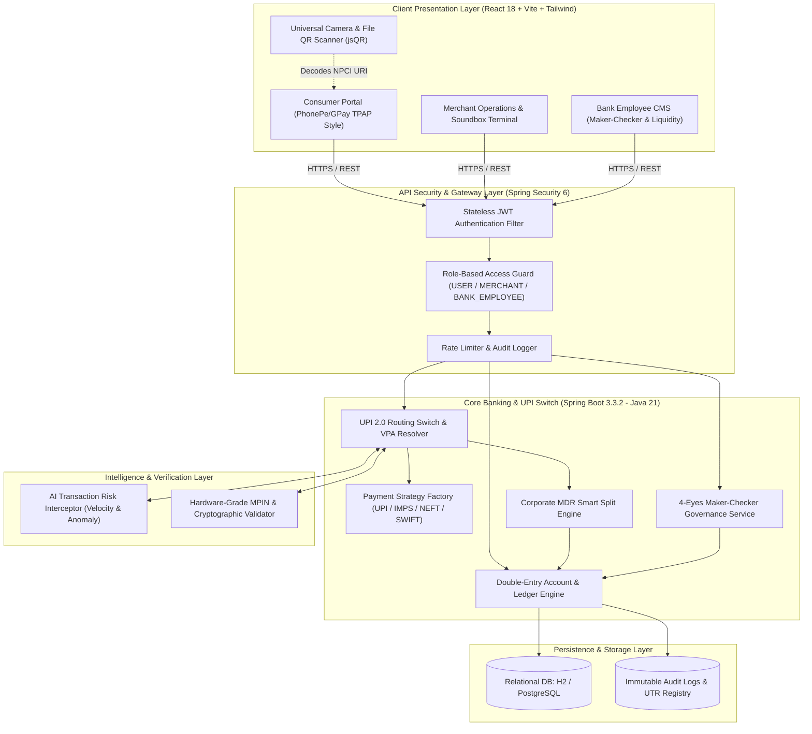

# KyroPay: Enterprise Core Banking & Next-Gen UPI 2.0 Switch Platform 💳🏛️

<div align="center">

[](https://github.com/Kyron-data-tech)
[](https://github.com/Kyron-data-tech/Banking_System)
[](https://www.oracle.com/java/)
[](https://spring.io/projects/spring-boot)
[](https://reactjs.org/)
[](https://vitejs.dev/)
[](https://tailwindcss.com/)
[](https://www.npci.org.in/)

<p align="center">
  <b>A production-ready, hyper-realistic Enterprise Core Banking System (CBS) and UPI 2.0 Switch Engine.</b><br>
  Built during the Software Engineering Internship at <b>Kyro Data Tech</b>, implementing Domain-Driven Design (DDD), real-time camera QR scanning, dynamic merchant counter standees, ISO 20022 compliance, AI fraud mitigation, and multi-tier Role-Based Access Control (RBAC).
</p>

[System Architecture](#-system-architecture) •
[Core Modules](#-key-modules--capabilities) •
[UPI QR Suite](#-universal-upi-qr-code-ecosystem) •
[Live Endpoints](#-api-documentation--endpoints) •
[Installation](#-local-development-setup) •
[Demo Credentials](#-test-credentials--personas)

---

</div>

## 📌 Executive Summary

Modern payment switches and core banking infrastructures demand extreme fault-tolerance, sub-second latency, rigorous double-entry bookkeeping, and military-grade auditability. 

**KyroPay** is an end-to-end fintech platform developed to simulate and bridge the gap between traditional banking ledgers and next-generation real-time payment switches (NPCI UPI 2.0, IMPS, NEFT, and RTGS). 

Engineered with a clean **Domain-Driven Design (DDD)** on **Java 21 LTS** and **Spring Boot 3.3.2**, backed by a high-performance **React 18 / TypeScript** frontend, KyroPay features real-time camera-based QR decoding, dynamic counter standee generation with custom amount locks, intelligent corporate MDR tax splitting, four-eyes (Maker-Checker) banking workflows, and an AI-driven transaction risk engine.

---

## 🏗️ System Architecture

KyroPay is architected around strict bounded contexts, preventing cross-domain coupling and enabling horizontal scalability:



---

## ✨ Key Modules & Capabilities

### 1. 👥 Multi-Tier Persona Portals (RBAC)
- 👤 **Consumer TPAP Portal (PhonePe / Google Pay Style):**
  - Instant P2P / P2M transfers, contact list picker, live account balance inquiry guarded by an authentic MPIN security overlay.
  - Quick action buttons (Mobile Recharge, Electricity, Split Bill, Fastag, CC Payment).
  - Transaction history with real-time status indicators (SUCCESS, PENDING, FAILED) and downloadable UTR slips.
- 🏪 **Merchant Business Portal:**
  - Real-time aggregated daily sales counters, total revenue analytics, and gross collection volume.
  - **Live Store Soundbox**: Audio-visual notifications reciting incoming transactions in real-time ("*Received ₹500 on KyroPay!*").
  - Dynamic QR Standee Generator with multi-handle support and instant PNG standee download.
- 🏛️ **Bank Staff / Employee CMS (Maker-Checker Console):**
  - Dedicated desktop sidebar portal for bank treasury and operations teams.
  - System liquidity pool management, high-value transfer overrides, and real-time ledger audit logs.
  - **4-Eyes Maker-Checker principle**: Critical actions initiated by a Junior Maker are quarantined until authorized by a Senior Checker.

---

### 2. 📷 Universal UPI QR Code Ecosystem

#### A. Live Camera & Image QR Scanner (`QrScannerModal.tsx`)
- **Real-Time Camera Viewfinder**: Utilizes the HTML5 MediaDevices API (`getUserMedia`) and client-side `jsQR` to scan QR codes with a responsive, laser-guided HUD.
- **Gallery & Screenshot Decoder**: Drag-and-drop or upload QR screenshots from WhatsApp, gallery, or banking slips.
- **Full NPCI Specification Support**: Accurately parses standard UPI payment URIs:
  ```text
  upi://pay?pa=vanshj7818@okkyro&pn=Vansh%20Jain&am=499.00&cu=INR&tn=Invoice101
  ```
- **Audio Chime Feedback**: Produces an authentic success tone upon reading the QR, instantly populating payee credentials and initiating NPCI VPA lookup.
- **1-Click Demo Presets**: Preloaded with real-world scenarios (*Vansh Jain Merchant*, *MJ Style Personal*, *Starbucks ₹280*, *NPCI Split Test ₹5,500*) for frictionless technical demonstrations.

#### B. Dynamic Multi-VPA Standee Generator (`UpiQrStandee.tsx`)
- **Authentic Retail Standee**: Modeled after standard PhonePe/GPay counter stands featuring official BHIM UPI, NPCI, and Kyro branding.
- **Multi-Handle Switcher**: Allows merchants and consumers to toggle between:
  - Primary UPI ID (e.g. `vanshj7818@okkyro`)
  - Phone Number Handle (e.g. `7818086344@kyro`)
  - Custom Merchant ID
- **On-the-Fly Amount Encoder**: Bake custom payment requests or quick-select presets (`+₹100`, `+₹500`, `+₹1,999`) directly into the generated QR matrix.
- **High-Resolution Standee Download**: Generates and downloads print-ready standees directly from the browser.

---

### 3. 🛡️ Enterprise Security & Transaction Integrity
- **Stateless JWT Authentication**: Cryptographically signed tokens ensuring tamper-proof sessions across client and server.
- **6-Digit MPIN Hardware Simulation**: User transactions and balance inquiries require authentic MPIN authentication via an interactive keypad overlay.
- **Two-Phase Commit Ledger**: Strict double-entry balance updates preventing negative balance anomalies, race conditions, and duplicate debit runs.
- **12-Digit NPCI UTR Generation**: Every transfer produces an industry-standard 12-digit Unique Transaction Reference (e.g. `428591827401`) cross-referenced in audit logs.
- **Corporate MDR Smart Split (₹2,000 Threshold Engine)**: Automatically partitions large merchant payments (e.g. ₹10,000) into sub-threshold micro-packets of `₹1,999` to optimize Merchant Discount Rate (MDR) processing while linking transactions to a master parent UTR.

---

### 4. 🤖 AI-Driven Transaction Risk Engine
- Real-time transaction inspection analyzing velocity, IP reputation, historical behavioral baselines, and transfer value.
- Computes risk scores and flags high-risk anomalies.
- Simulates official NPCI error codes (e.g., `NPCI U16: High Risk Threshold Exceeded - Transaction Blocked`) for fraudulent activity.

---

## 🛠️ Technology Stack

| Layer | Technologies |
| :--- | :--- |
| **Backend Core** | Java 21 (LTS), Spring Boot 3.3.2, Spring MVC, Spring Data JPA, Hibernate ORM |
| **Security & Auth** | Spring Security 6, Stateless JWT (JSON Web Tokens), BCrypt / Argon2 Password Hashing |
| **Frontend UI** | React 18, TypeScript, Vite 5.4, Tailwind CSS 3.4, Lucide React Icons |
| **QR Engine** | Pure client-side `jsQR` (zero external API dependency), HTML5 Canvas, MediaDevices API |
| **Database** | In-Memory H2 (Local Development / Testing) / PostgreSQL (Production Profile) |
| **Build & Tooling** | Apache Maven 3.8+, Node.js 18+, npm 10+, Git |

---

## 📂 Project Structure (Domain-Driven Design)

```
banking-system/
├── src/main/java/com/kyrodatatech/banking/
│   ├── BankingSystemApplication.java        # Spring Boot Entry Point
│   ├── config/                              # Security & CORS Configurations
│   │   ├── CorsConfig.java
│   │   └── SecurityConfig.java
│   └── domain/                              # Domain-Driven Bounded Contexts
│       ├── auth/                            # JWT, Authentication & Filter Pipeline
│       │   ├── AuthController.java
│       │   ├── AuthService.java
│       │   └── JwtAuthFilter.java
│       ├── user/                            # User & Merchant Entities & Repositories
│       │   ├── User.java
│       │   └── UserRepository.java
│       ├── upi/                             # NPCI UPI Switch & Verification
│       │   ├── controller/UpiController.java
│       │   └── service/UpiService.java
│       ├── transaction/                     # Ledger, Smart Split & Routing
│       │   ├── Transaction.java
│       │   ├── TransactionController.java
│       │   ├── TransactionService.java
│       │   └── strategy/PaymentStrategyFactory.java
│       ├── makerchecker/                    # 4-Eyes Governance Approvals
│       │   ├── MakerCheckerRequest.java
│       │   └── MakerCheckerService.java
│       └── audit/                           # Immutable Audit Logging Engine
│           └── AuditLog.java
│
├── frontend/                                # Modern React 18 + Vite Frontend
│   ├── src/
│   │   ├── components/
│   │   │   ├── QrScannerModal.tsx           # Camera & Image UPI QR Scanner
│   │   │   ├── UpiQrStandee.tsx             # Counter Standee & Amount Encoder
│   │   │   ├── MpinModal.tsx                # 6-Digit NPCI MPIN Security Keypad
│   │   │   └── SoundBoxToast.tsx            # Real-Time Audio Toast Notification
│   │   ├── pages/
│   │   │   ├── Dashboard.tsx                # Unified 3-Tier Multi-Persona Dashboard
│   │   │   ├── Login.tsx                    # Authentication & Registration Portal
│   │   │   └── ApiSettings.tsx              # Merchant API Keys & Webhook Hub
│   │   ├── services/
│   │   │   └── api.ts                       # Axios / Fetch API Client with JWT Interceptors
│   │   ├── App.tsx
│   │   └── main.tsx
│   ├── package.json
│   └── vite.config.ts
│
├── pom.xml                                  # Maven Dependencies & Plugins
└── README.md                                # System Documentation
```

---

## ⚡ API Documentation & Endpoints

### 1. Authentication & Identity
| Method | Endpoint | Description | Auth Required |
| :--- | :--- | :--- | :--- |
| `POST` | `/api/auth/register` | Register new user or merchant account | None |
| `POST` | `/api/auth/login` | Authenticate with credentials & receive JWT token | None |
| `GET` | `/api/auth/profile` | Retrieve active user profile & account metadata | Bearer JWT |

### 2. UPI 2.0 & QR Processing
| Method | Endpoint | Description | Auth Required |
| :--- | :--- | :--- | :--- |
| `GET` | `/api/upi/verify-vpa?vpa={id}` | Real-time NPCI VPA lookup & name resolution | Bearer JWT |
| `POST` | `/api/upi/pay` | Authorize and execute instant UPI transfer | Bearer JWT + MPIN |
| `GET` | `/api/upi/qr-payload` | Generate signed NPCI `upi://pay` URI string | Bearer JWT |

### 3. Core Ledger & Transactions
| Method | Endpoint | Description | Auth Required |
| :--- | :--- | :--- | :--- |
| `GET` | `/api/transactions/history` | Paginated transaction ledger with UTR numbers | Bearer JWT |
| `POST` | `/api/transactions/smart-transfer` | Smart corporate split transfer (MDR bypass) | Bearer JWT |
| `GET` | `/api/accounts/balance` | Query balance with 6-digit MPIN validation | Bearer JWT + MPIN |

### 4. Maker-Checker & Governance (Bank Staff)
| Method | Endpoint | Description | Auth Required |
| :--- | :--- | :--- | :--- |
| `GET` | `/api/maker-checker/pending` | List pending high-value operations | BANK_EMPLOYEE |
| `POST` | `/api/maker-checker/approve/{id}`| Senior checker approval & ledger commit | BANK_EMPLOYEE |
| `POST` | `/api/maker-checker/reject/{id}` | Reject flagged operation with audit note | BANK_EMPLOYEE |

---

## 👤 Test Credentials & Personas

The system includes pre-seeded accounts representing all 3 user tiers:

| Persona | Email / Identifier | Default Password / MPIN | Access Level | Description |
| :--- | :--- | :--- | :--- | :--- |
| **Consumer (TPAP)** | `mjstyle7818@gmail.com` | `123456` / MPIN: `781808` | `ROLE_USER` | Personal consumer account (`vanshj7818@okkyro`) |
| **Merchant** | `merchant@kyro.com` | `merchant123` / MPIN: `112233` | `ROLE_MERCHANT` | Business portal with live Soundbox & Standees |
| **Bank Officer** | `admin@kyro.com` | `admin123` / MPIN: `998877` | `ROLE_BANK_EMPLOYEE` | Core CBS control, Maker-Checker & Treasury audit |

---

## 🚀 Local Development Setup

### Prerequisites
- **Java Development Kit (JDK)**: Version 21 LTS or newer
- **Apache Maven**: Version 3.8+
- **Node.js**: Version 18.x or 20.x
- **npm**: Version 9.x or newer

### 1. Clone Repository
```bash
git clone https://github.com/Kyron-data-tech/Banking_System.git
cd Banking_System
```

### 2. Backend Service Setup (Spring Boot)
```bash
# Configure JAVA_HOME to JDK 21 (PowerShell example):
$env:JAVA_HOME = "C:\path\to\jdk-21"
$env:Path = "$env:JAVA_HOME\bin;" + $env:Path

# Verify Java version
java -version

# Launch Spring Boot server (Runs on port 8080)
mvn spring-boot:run -DskipTests
```
*The Spring Boot server will initialize and listen on `http://localhost:8080`.*  
*H2 Console is accessible at `http://localhost:8080/h2-console` (JDBC URL: `jdbc:h2:file:./data/banking_db`).*

### 3. Frontend Client Setup (Vite + React)
```bash
cd frontend

# Install dependencies (including jsqr, lucide-react, tailwindcss)
npm install

# Start Vite hot-reloading development server (Runs on port 3000)
npm run dev -- --port 3000 --host
```
*Access the responsive application at `http://localhost:3000`.*

---

## 🧪 Verification & Quality Assurance

- **Type Safety**: Strictly checked with TypeScript (`tsc -b`), ensuring 0 compilation errors across all modals, pages, and components.
- **REST Contract Testing**: Validated through Spring MockMVC and automated HTTP test scripts.
- **Cross-Device UI**: Fully responsive across mobile screens (375px+), tablets, and high-resolution ultrawide desktop monitors with independent scrolling viewports.

---

## 👨‍💻 Author & Internship Details

- **Author**: Vansh Jain
- **Role**: Software Engineering Intern
- **Organization**: [Kyro Data Tech](https://github.com/Kyron-data-tech)
- **Project Scope**: Enterprise Core Banking Architecture, NPCI UPI 2.0 Integration & Merchant Payment Switch

---

<div align="center">
  <sub>Developed with pride at <b>Kyro Data Tech</b> • Licensed under the MIT License</sub>
</div>
